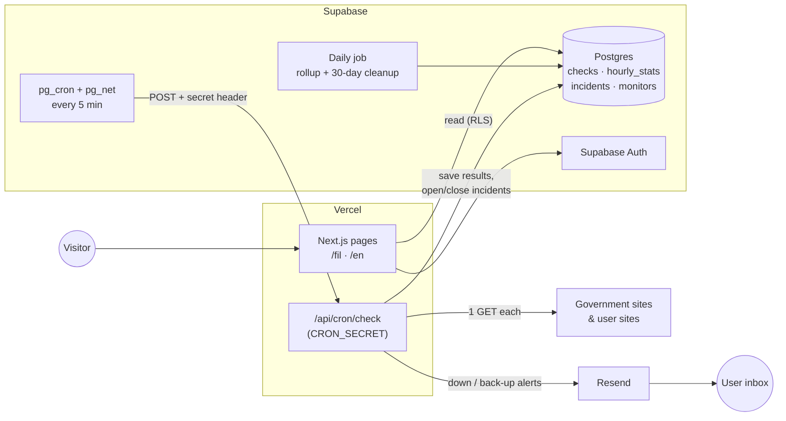

# Online Na Ba?

**Is it online? A free, public status page for Philippine government websites, plus the best times to use them.**

[🇵🇭 Filipino](#) · [🇬🇧 English](#) · **Live site:** _coming soon_

> ⚠️ **Unofficial.** This project has no affiliation with any government agency. It only checks whether public pages respond. It never logs in, registers, or automates anything on government sites.

<!-- Screenshot: status board (mobile + desktop) -->
<!--  -->

---

## Why

Government portals like Virtual Pag-IBIG are often down, or only accept registrations at certain times. People lose hours hitting refresh. **Online Na Ba?** checks these sites every 5 minutes and turns the results into something useful:

- **Right now:** is the site Online, Mabagal (slow), or Hindi ma-access (down)?
- **When to try:** a "best time to access" heatmap built from 30 days of real uptime data, in Manila time.

Signed-in users can also monitor **their own websites** and get email alerts when they go down and come back up.

## Features

**Public, no login needed**

- Status board for 15 government sites, grouped by category, showing current status, response time, and 24-hour and 7-day uptime
- Detail page for each site with a response-time chart, recent outages, and a best-time heatmap (hour × day of week)
- English and Filipino throughout, with Filipino as the default

**Signed-in users**

- Up to 3 personal monitors you can add, edit, pause, or delete
- Email alerts when a monitor goes down (after 2 failed checks) and when it recovers, with the outage duration
- Alerts arrive in your chosen language

### Monitored sites

| Category | Sites |
|---|---|
| Benefits & contributions | Pag-IBIG Fund, Virtual Pag-IBIG, SSS, My.SSS, PhilHealth |
| IDs & documents | DFA Passport Appointment, PSA Serbilis, NBI Clearance, PhilSys National ID, LTO LTMS |
| Tax & licensing | BIR (main + eBIRForms), PRC LERIS |
| Others | COMELEC, eGov PH, Civil Service Commission |

Sites are stored as seed data in the database, so adding one doesn't need a code change.

## How checks work

Every active monitor gets **one GET request every 5 minutes**:

| Status | English | Filipino | Rule |
|---|---|---|---|
| 🟢 Up | Online | Online | Responds in ≤ 5 s with a status code below 500 |
| 🟡 Slow | Slow | Mabagal | Responds in > 5 s, or returns 429 |
| 🔴 Down | Down | Hindi ma-access | 5xx error, or no response within 15 s |

- **4xx counts as up.** It usually means the server is alive but blocking bots.
- **Incidents** open after 2 consecutive down checks and close on the first up check.
- **Uptime %** = (up + slow) ÷ all checks in the period.

### Being gentle on government servers

- At most one request per site every 5 minutes, with no retries
- The response body is cancelled after reading the status, so pages are never downloaded
- An honest User-Agent that names the bot and links to the About page
- No logins, form submissions, scraping, or getting around queues and time slots

## Tech stack

| Layer | Choice |
|---|---|
| Framework | Next.js (App Router, TypeScript strict) on Vercel |
| Database + auth | Supabase Postgres + Supabase Auth, with row-level security on every table |
| Scheduler | Supabase Cron (pg_cron + pg_net) |
| Email | Resend |
| Charts | Recharts |
| Translation | next-intl (`/fil` and `/en` routes) |
| Styling | Tailwind CSS |

## Architecture



**Why Supabase Cron instead of Vercel Cron?** Vercel's free Hobby plan only runs cron jobs once a day. Supabase Cron calls the protected check route every 5 minutes instead, and the route rejects any request without the `CRON_SECRET` header.

### Data model

| Table | Holds |
|---|---|
| `profiles` | One row per user: plan, preferred language |
| `monitors` | Sites being checked: name, URL, category, public/private, owner, active |
| `checks` | One row per check: status, status code, response time, error (kept 30 days) |
| `hourly_stats` | Checks rolled up per monitor per hour (kept forever) |
| `incidents` | Consecutive down periods with start, end, and duration |
| `alert_settings` | Who gets alerted for which monitor |

At about 4,300 checks a day, a daily job rolls raw checks into `hourly_stats` and deletes anything older than 30 days. That keeps the database inside Supabase's free tier.

## Running locally

**Requirements:** Node.js 20+, the [Supabase CLI](https://supabase.com/docs/guides/cli), and Docker (for local Supabase).

```bash
git clone <repo-url>
cd online-na-ba
npm install

# Start local Supabase, then apply migrations and seed data
supabase start
supabase db reset

# Set up environment variables
cp .env.example .env.local
# Fill in the values printed by `supabase start`, plus your Resend key

npm run dev
```

Open http://localhost:3000/fil (or `/en`).

Run the tests, typecheck and lint with `npm test`, `npm run typecheck` and `npm run lint`.

To trigger a check run by hand:

```bash
curl -X POST http://localhost:3000/api/cron/check \
  -H "Authorization: Bearer $CRON_SECRET"
```

### Environment variables

See `.env.example` for the full list.

| Variable | Used for | Exposed to browser? |
|---|---|---|
| `NEXT_PUBLIC_SUPABASE_URL` | Supabase project URL | Yes |
| `NEXT_PUBLIC_SUPABASE_PUBLISHABLE_KEY` | Public client key, `sb_publishable_...` (limited by RLS) | Yes |
| `SUPABASE_SECRET_KEY` | Server-only key, `sb_secret_...`, for writing checks, stats and incidents | **No** |
| `CRON_SECRET` | Protects `/api/cron/check` | **No** |
| `RESEND_API_KEY` | Sending alert emails | **No** |

## Demo

A demo account with sample monitors will be listed here and on the About page at launch.

## Hard problems solved

### A healthy site that `fetch()` said was down

On the very first test run, Virtual Pag-IBIG came back **down** with `UND_ERR_RES_CONTENT_LENGTH_MISMATCH`, even though it loaded fine in a browser. A lower-level request showed the real cause: its server sends **obsolete folded headers** (a `Set-Cookie` value continued on the next line after a leading space). Browsers accept this, but Node's strict HTTP parser rejects the whole response.

The checker now uses Node's `http`/`https` client with `insecureHTTPParser` (as lenient as a browser) instead of `fetch()`. That's safe here because we only read the status line and `Location` header. It also follows redirects by hand, under a single 15-second deadline, and destroys the socket as soon as the headers arrive, so no page is ever downloaded. A regression test reproduces the bad header with a raw TCP server.

### Still to write up

- Running 5-minute checks on free tiers (Supabase Cron calling a protected Vercel route)
- Status rules that are fair to bot-blocking sites (4xx as up, 429 as slow)
- Incident detection without alert spam (2-check threshold, one alert per incident)
- Keeping time-series data within free-tier limits (hourly rollups + 30-day retention)
- Best-time heatmap in Asia/Manila time from UTC data
- Full Filipino/English support, including emails, with locale-prefixed routes

## Findings

_Coming after a few weeks of data: which government site is most reliable, and when._

## Roadmap

- [ ] **v1:** public status board, site detail pages, accounts, personal monitors, email alerts, EN/FIL
- [ ] **v2:** "notify me when it's back" for visitors, Telegram alerts, Pro tier (Stripe test mode), shareable status pages, weekly report

## Disclaimer

Online Na Ba? is an independent project and is **not affiliated with, endorsed by, or operated by** any Philippine government agency. Status data comes from automated checks of public pages and may not match what you see. Always use official channels for transactions.

---

Made in the Philippines 🇵🇭
