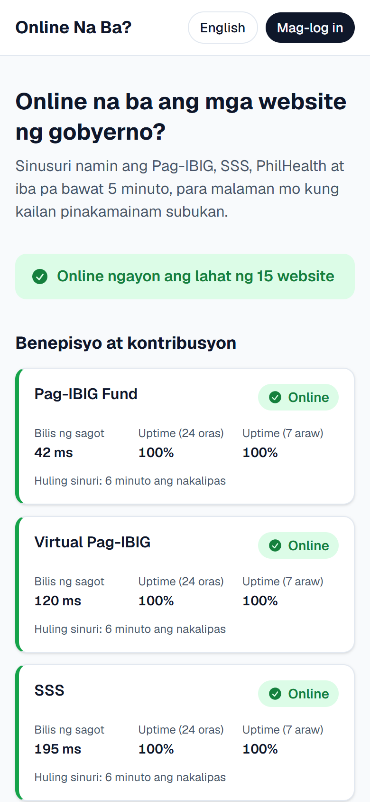
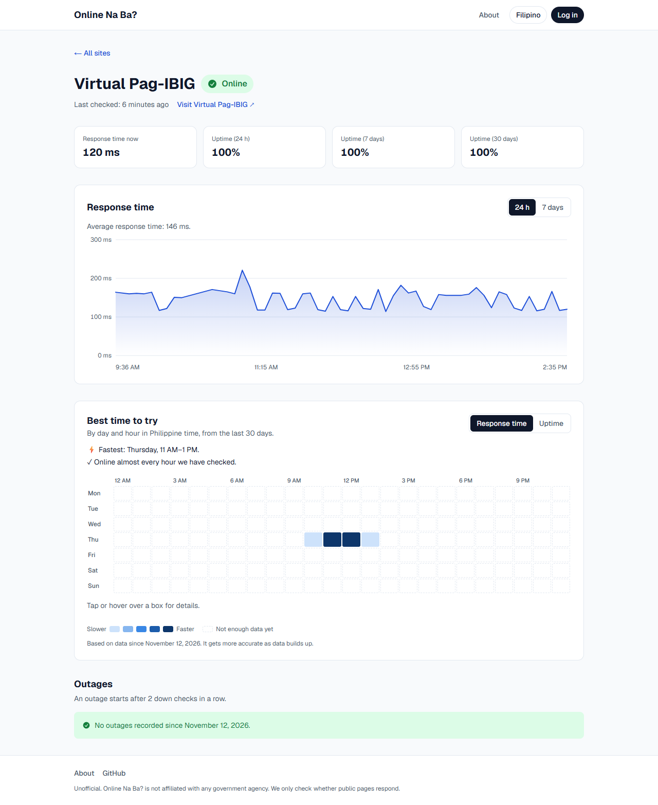
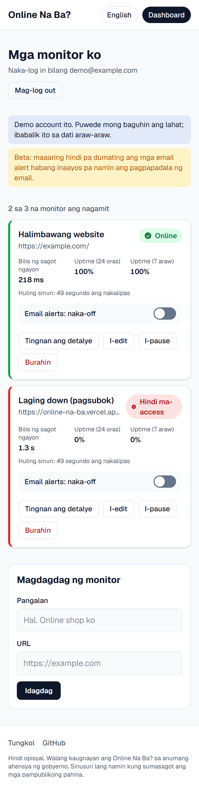
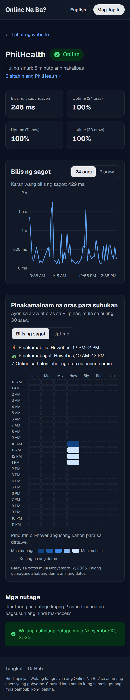
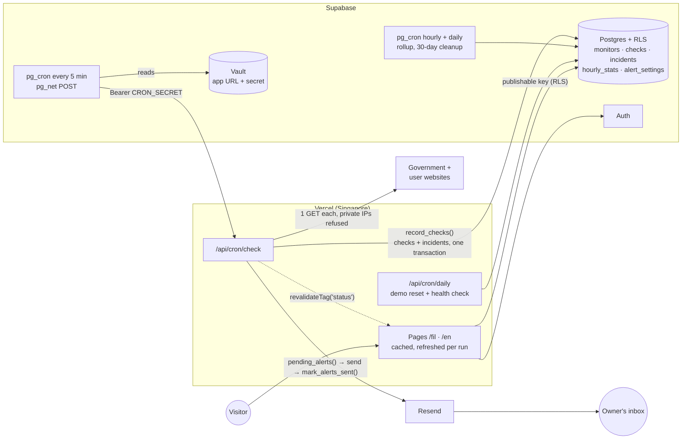

# Online Na Ba?

**Is it online? A free, public status page for Philippine government websites, and the best times to use them.**

**Live:** [online-na-ba.vercel.app](https://online-na-ba.vercel.app) · [🇵🇭 Filipino](https://online-na-ba.vercel.app/fil) · [🇬🇧 English](https://online-na-ba.vercel.app/en) · **Try the dashboard:** press *Try the demo* on the [login page](https://online-na-ba.vercel.app/en/login)

> ⚠️ **Unofficial.** Not affiliated with any government agency. It only checks whether public pages respond, and never logs in, registers or automates anything on government sites.

<p>
  
  &nbsp;
  
</p>

## Why

Government portals like Virtual Pag-IBIG are often down, or only accept registrations at certain times. People lose hours hitting refresh. Online Na Ba? checks 15 of these sites every 5 minutes and turns the results into two answers:

- **Right now:** is it *Online*, *Mabagal* (slow) or *Hindi ma-access* (down)?
- **When to try:** a heatmap of the fastest and most reliable hours by day of week, in Manila time.

Signed-in users can also monitor up to 3 of their own websites and get an email when one goes down and when it comes back.

## Features

**For everyone, no login**
- Status board for 15 government sites, grouped by category: status, response time, 24-hour and 7-day uptime
- A page per site: response-time chart (24 h / 7 days), best-time heatmap (response time or uptime), recorded outages
- Filipino by default, English one tap away, on every page and in emails
- Link previews (Open Graph) that show the live "X of 15 online" count

**With a free account**
- Dashboard with up to 3 personal monitors: add, edit, pause, delete
- "Down" and "back up" emails in your language, with the reason and the outage length, plus one-click unsubscribe
- The same chart, heatmap and outage history for your own sites

| | |
|---|---|
|  |  |

### Monitored sites

| Category | Sites |
|---|---|
| Benefits & contributions | Pag-IBIG Fund, Virtual Pag-IBIG, SSS, My.SSS, PhilHealth |
| IDs & documents | DFA Passport Appointment, PSA Serbilis, NBI Clearance, PhilSys National ID, LTO LTMS |
| Tax & licensing | BIR, PRC LERIS |
| Others | COMELEC, eGov PH, Civil Service Commission |

The list is seed data in the database, so adding a site needs no code change.

## How checks work

Every active monitor gets **one GET request every 5 minutes**, from Vercel's Singapore region (the closest to the Philippines):

| Status | Filipino | English | Rule |
|---|---|---|---|
| 🟢 Up | Online | Online | Answers within 5 s with a status below 500 |
| 🟡 Slow | Mabagal | Slow | Answers after more than 5 s, or returns 429 |
| 🔴 Down | Hindi ma-access | Down | 5xx, or no answer within 15 s |

- **4xx counts as up:** the server is alive, it just blocks bots.
- **Outages** open after 2 down checks in a row and close at the first check that answers.
- **Uptime** = (up + slow) ÷ all checks in the period.

**Going easy on government servers:** one request per site per run and no retries; only the status line is read and the connection is dropped, so pages are never downloaded; the bot identifies itself as `shey/1.0 (uptime monitor; +https://online-na-ba.vercel.app/en/about)`; no logins, forms, scraping, or getting around queues.

## Tech stack

| Layer | Choice |
|---|---|
| Framework | Next.js 16 (App Router, Cache Components, TypeScript strict) on Vercel |
| Database + auth | Supabase Postgres + Supabase Auth, row-level security on every table |
| Scheduling | Supabase Cron (pg_cron + pg_net) every 5 min and hourly; Vercel Cron daily |
| Email | Resend |
| Charts | Hand-built SVG (response time) and an HTML table (heatmap) |
| Translation | next-intl, `/fil` and `/en` routes |
| Styling | Tailwind CSS 4 |
| Tests | Vitest, PGlite (in-memory Postgres), Puppeteer, Lighthouse |

## Architecture



- **Why Supabase Cron?** Vercel's free plan runs cron jobs once a day. pg_cron calls the protected check route every 5 minutes; the URL and secret live in Supabase Vault, not in the repo.
- **Why cached pages?** Public pages are prerendered and cached, and the check route invalidates the cache tag after each run, so pages are fast and still current.

### Data and retention

| Table | Holds | Kept |
|---|---|---|
| `profiles` | Plan, preferred language (one per user) | |
| `monitors` | Public sites and personal monitors | |
| `checks` | One row per check: status, code, response time, error | 30 days |
| `hourly_stats` | Checks summarized per monitor per hour | Forever |
| `incidents` | Outages, plus when each alert was sent | |
| `alert_settings` | Alerts on/off per personal monitor | |

About 4,300 checks a day. An hourly job summarizes finished hours and a daily job deletes raw checks older than 30 days, which keeps the database on Supabase's free tier while the heatmap keeps its history.

### Security

- **Row-level security on every table**, plus column-level grants: users can't make a monitor public, change their plan, or write check results. Checked by the database tests and by a live test against production (`npm run test:rls`).
- **SSRF protection:** user-entered URLs can't reach private networks. URLs are validated on save and in the database; at check time DNS is resolved by our own lookup that refuses private, loopback, link-local and CGNAT addresses, the socket connects to the approved address (defeating DNS rebinding), and every redirect hop is re-checked.
- **Secrets stay server-side:** the secret key, cron secret and Resend key never reach the browser; `npm run launch-check` scans the whole git history for secrets.
- **Signed one-click unsubscribe links** (HMAC) work without logging in, but require a click so mail scanners can't unsubscribe people.

## Hard problems solved

### 1. A healthy site that `fetch()` said was down
On the first test run, Virtual Pag-IBIG came back down with `UND_ERR_RES_CONTENT_LENGTH_MISMATCH`, though it loaded fine in a browser. Its server sends **obsolete folded headers** (a `Set-Cookie` value continued on the next line). Browsers accept that; Node's strict parser rejects the response. The checker uses Node's `http`/`https` with `insecureHTTPParser` instead of `fetch()`, which is safe because only the status line and `Location` header are read. It follows redirects itself under one 15-second deadline. A test reproduces the header with a raw TCP server.

### 2. From 79 to 98 on Lighthouse by dropping the chart library
The site page scored 79–83 on mobile: Recharts cost about 0.9 s of main-thread time on a throttled phone. It was replaced with a server-rendered SVG: the plot is stretched to its box with non-scaling 2px strokes, while labels, outage dots and the tooltip are HTML positioned in percent, so text stays crisp. The heatmap's 336 small buttons (which failed the tap-target audit and added 168 tab stops) became plain table cells with screen-reader text and one pointer handler. Result: 94–98 on every page.

### 3. Alerts that are never lost and never doubled
Incidents record when each alert went out. Every run asks `pending_alerts()` what still needs sending, sends it, then `mark_alerts_sent()` records it, conditionally, so overlapping runs can't double-send. A failed send is simply retried next run, and a Resend idempotency key per incident covers a crash between sending and marking. "Back up" is only sent if "down" was, flapping sites are capped at 6 emails an hour, and permanent rejections stop retrying.

### 4. Environment variables that existed at build time but not at runtime
Public values set as Vercel "Config" variables were available during the build but not to functions at runtime, so `process.env[name]` came back empty in production. Writing them as literal `process.env.NEXT_PUBLIC_*` references lets Next.js inline them at build time. A URL pasted with `/rest/v1/` on the end (which the Supabase client adds again) is also normalized.

### 5. Filipino by default, even on English phones
Most phones in the Philippines send `Accept-Language: en`, which would override a Filipino default. The proxy drops that header before locale detection, so visitors get Filipino unless they choose English (remembered in a cookie, and in the profile for signed-in users, so emails follow). A test makes sure every component that runs in the browser only uses message namespaces that are actually sent to it (it caught a real bug: raw keys like `Status.paused` on the dashboard).

### 6. Noticing when the checks stop
On day one the 5-minute cron job disappeared for 20 minutes without anyone noticing at first. `health_report()` now reports whether the job exists, the runs in the last 24 hours and the longest gap; a daily job emails the owner when something is off, and `npm run launch-check` lists every gap since data collection began.

## Tests

| Command | What it checks |
|---|---|
| `npm test` | 211 unit tests: status rules, redirects and malformed headers against raw TCP servers, SSRF blocking, chart and heatmap math, email content, validation, translations |
| `npm run test:db` | 138 database checks in PGlite: every migration and the seed, RLS between users, column privileges, the monitor limit, incidents, the alert outbox, rollup and cleanup |
| `npm run test:rls` | 23 checks against the **live** project with two temporary users: user B can't read or change anything of user A's (cleans up after itself) |
| `npm run launch-check` | The Definition-of-done audit: secrets in git history, `.env.example` coverage, every page in both languages (disclaimer, translations, hreflang), data continuity |
| `npm run typecheck`, `npm run lint` | TypeScript strict, ESLint |

End-to-end browser runs (sign-up/login, dashboard actions, alert settings, demo reset) and the alert emails were verified against the real deployment during development.

**Lighthouse (mobile, production):** homepage 98–99 · site page 94–98 · About 94–95 · login 97–98 · dashboard 97. Accessibility, best practices and SEO are 100 on every public page.

## Running it yourself

You need Node.js 20+, a free [Supabase](https://supabase.com) project, and optionally a [Resend](https://resend.com) API key (for alert emails) and a [Vercel](https://vercel.com) account.

```bash
git clone https://github.com/vrixcabrera22/online-na-ba.git
cd online-na-ba
npm install
cp .env.example .env.local      # fill in your Supabase URL and keys, and a CRON_SECRET

# Database: link your project, then apply all migrations and the seed
npx supabase login
npx supabase link --project-ref <your-project-ref>
npx supabase db push --include-seed

npm run dev                     # http://localhost:3000/fil
```

Trigger a check run by hand:

```bash
curl -X POST http://localhost:3000/api/cron/check -H "Authorization: Bearer $CRON_SECRET"
```

**Scheduling in production.** Deploy to Vercel with the variables below, then store the deployed URL and the cron secret in Supabase Vault (the schedule migration reads them at run time):

```sql
select vault.create_secret('https://<your-app>.vercel.app', 'app_url');
select vault.create_secret('<same value as CRON_SECRET>', 'cron_secret');
```

The 5-minute check, hourly rollup and daily cleanup are created by the migrations; the daily demo reset and health check run from `vercel.json`.

### Environment variables

| Variable | Used for | In the browser? |
|---|---|---|
| `NEXT_PUBLIC_SITE_URL` | Links in emails, the bot's User-Agent, canonical URLs | Yes |
| `NEXT_PUBLIC_SUPABASE_URL` | Supabase project URL | Yes |
| `NEXT_PUBLIC_SUPABASE_PUBLISHABLE_KEY` | Public key (`sb_publishable_…`), limited by RLS | Yes |
| `SUPABASE_SECRET_KEY` | Server-only key (`sb_secret_…`): checks, incidents, alerts, demo reset | **No** |
| `CRON_SECRET` | Protects the cron routes; also derives unsubscribe-link signatures | **No** |
| `RESEND_API_KEY` | Sending alert emails | **No** |
| `ALERTS_FROM` | Optional sender once a domain is verified in Resend | **No** |
| `HEALTH_EMAIL` | Optional: where the daily health check reports problems | **No** |

## Findings

*Written up after two weeks of data (on or after November 26, 2026): which government sites are most reliable, and when they are fastest.*

## Known limitations

- **Alert emails are in limited beta.** Without a verified sending domain, Resend only delivers to the account owner; other users see a beta note on the dashboard. Adding a domain only needs `ALERTS_FROM`.
- **Sign-up confirmation emails** use Supabase's built-in sender, which allows only a few emails per hour.
- **Status is measured from Singapore** against each site's public page. It can differ from what a visitor sees on a crowded login page.

## Roadmap

- [x] **v1:** public status board, site pages with chart, heatmap and outages, accounts, personal monitors, email alerts, Filipino and English
- [ ] **v2:** "notify me when it's back" for visitors, Telegram alerts, a Pro tier (Stripe test mode, 1-minute checks), shareable status pages, weekly email report

## Disclaimer

Online Na Ba? is an independent project. It is **not affiliated with, endorsed by, or operated by** any Philippine government agency. Status data comes from automated checks of public pages and may not match what you see. Always use official channels for transactions.

---

Made in the Philippines 🇵🇭
